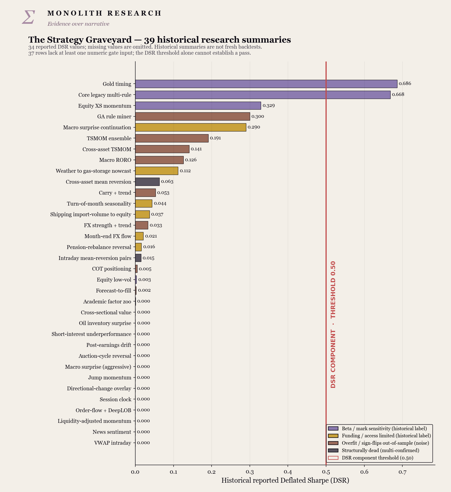

<div align="center">


# The Strategy Graveyard

**Research post-mortems, reproducible checks, and the limits of a good backtest.**

39 historical summaries · 8 case studies · Synthetic demonstration
</div>

Monolith Research's record of rejected and constrained trading ideas. The useful
result is often an identified failure: selection bias, ordinary market exposure,
execution costs, an unavailable data vintage, or a signal that disappears when
the experiment becomes tradeable.

These are **historical summary records**, not 39 newly reproduced backtests.
Only **2 rows contain all three numeric gate inputs**; both fail that screen.
The other **37 are incomplete for this numeric gate**. Missing evidence is not
a tested failure or a pass. Many cases have separate documented reasons for
rejection. No current live strategy or performance is claimed here.

## Reproduce the public checks

```bash
python -m pip install -r requirements.txt
python -m pytest -q
python scripts/audit_dataset.py
python scripts/demo_validation.py
python scripts/make_graveyard_chart.py
```

Python 3.14 was used for local verification. Tests and demonstrations run offline
after dependency setup. The demo generates its own inputs; the dataset audit
validates summary structure and evidence coverage, not underlying returns.

Start with [evidence and provenance](PROVENANCE.md), then the
[research lessons](WHY_IT_WORKS_THIS_WAY.md). The
[validation library](https://github.com/MonolithResearch/quant-validation)
is the companion technical project.

## The numeric screen

```text
DSR >= 0.50 AND PBO <= 0.20 AND OOS trades >= 50
```

These are this project's historical thresholds, not universal scientific cutoffs.
A numeric pass would still require reliable timing, full search accounting,
credible execution costs, exposure analysis and an appropriate confirmation test.
DSR is an approximation under assumptions; it does not certify truth or liquidity.



The chart shows 34 reported DSR values. Five records lack a reported DSR and are
omitted. The bars mix historically documented designs and evidence scopes; use
them for navigation, not as a standardized ranking of independently rerun studies.

## Eight post-mortems

- [Mean-reversion pairs](case_studies/01_ou_m5_stat_arb.md): search selection and
  an out-of-sample reversal.
- [Order flow and DeepLOB](case_studies/02_ofi_deeplob.md): predictive structure
  that did not clear the modeled execution-cost barrier.
- [Genetic-programming equity](case_studies/03_gp_us_equity.md): a promising
  development result rejected by a registered holdout.
- [COT anti-crowding](case_studies/04_cot_anti_crowding.md): weak held-out evidence
  and ordinary momentum exposure.
- [Weather and natural gas](case_studies/05_weather_gas_nowcast.md): forecast
  accuracy and tradeable incremental information are different questions.
- [Trend ensemble](case_studies/06_strategy_17_ensemble.md): a long-history
  reassessment of an earlier headline.
- [Option-implied vol-spread](case_studies/07_vol_spread_microcap.md): a favorable
  historical DSR failed to settle liquidity and universe sensitivity.
- [Closed-end-fund discounts](case_studies/08_cef_discount_reversion.md):
  residual beta and sensitivity to an execution delay.

The first six articles retain their historical wording. Their dated numerical and
operational statements are not assertions about present systems. The two added
articles distinguish reported measurements from interpretations of their cause.

## What a reviewer can inspect

`scripts/audit_dataset.py` validates schema, finite domains, unique ranks/names,
and complete versus missing gate evidence. `scripts/demo_validation.py` includes
actual combinatorially symmetric half-block validation with independent-reference
tests, explicit tie handling and no full-sample shortlist selection. Its small PBO
panel is illustrative and cannot certify a winner selected from a larger search.

Licensed market data, account records and trading credentials are not included.
The original empirical studies cannot be independently replayed from this public
summary alone. See [PROVENANCE.md](PROVENANCE.md) for that boundary and changes
made during the 2026-10-28 publication.

Maintained by **Bilal Malik / Monolith Research**.
[GitHub profile](https://github.com/05bilalmalik-cmd) ·
[Quantitative validation](https://github.com/MonolithResearch/quant-validation) ·
[Microstructure project](https://github.com/MonolithResearch/deeplob-microstructure)
